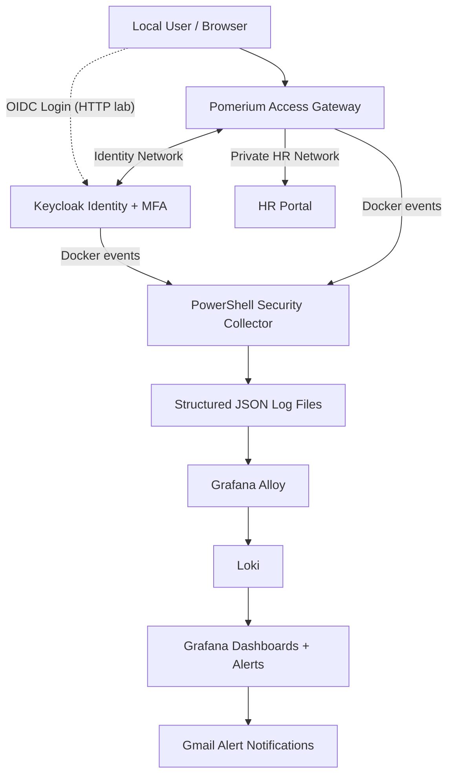

# SecureCorp - Security Architecture

## Architecture

## Docker Network Segmentation

| Network | Services |
|---|---|
| zt-identity | Keycloak, Pomerium |
| zt-hr-private | Pomerium, HR Portal |
| securecorp-monitoring_default | Grafana, Loki, Alloy |

## Demonstrated Security Controls

- Keycloak identity authentication and MFA
- Pomerium policy-based authorization
- Restricted contractor access
- Private HR application Docker network
- Authentication and authorization event collection
- Failed-login alerting with email notification

## Known Limitations

- Local development environment only
- Browser-facing TLS is not fully trusted/configured
- Keycloak login uses HTTP
- Production hardening is not complete
- Secrets and local credentials are intentionally excluded from Git
- Additional local configuration is required to reproduce the complete lab
